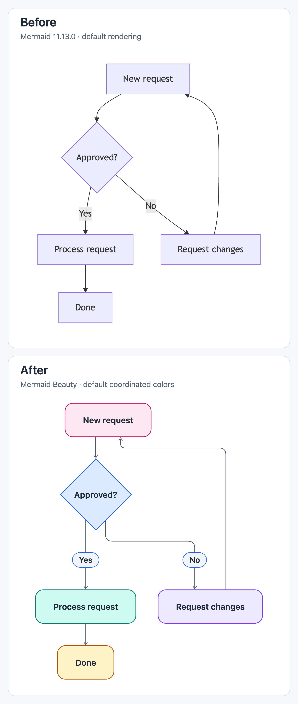
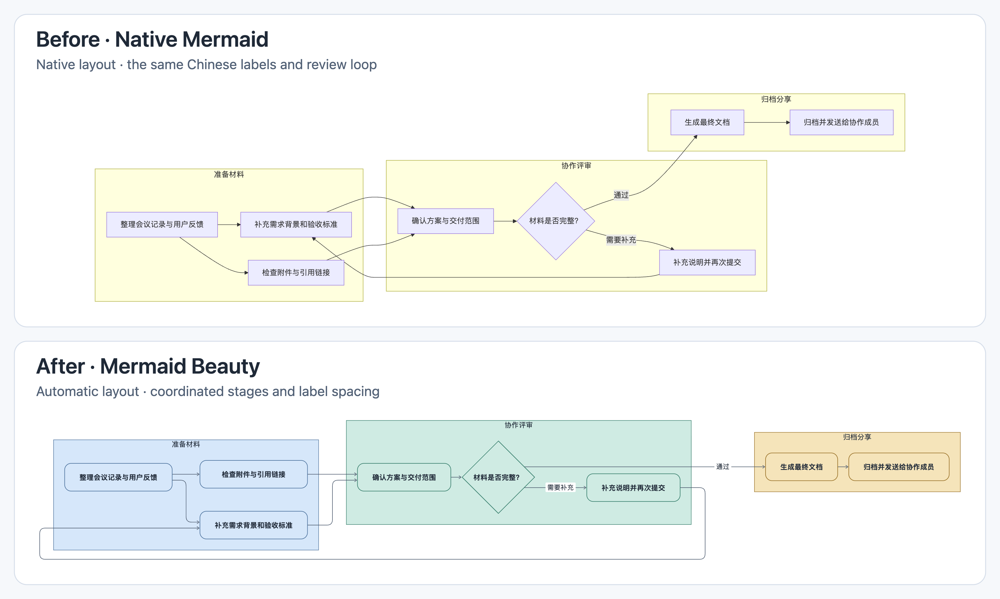
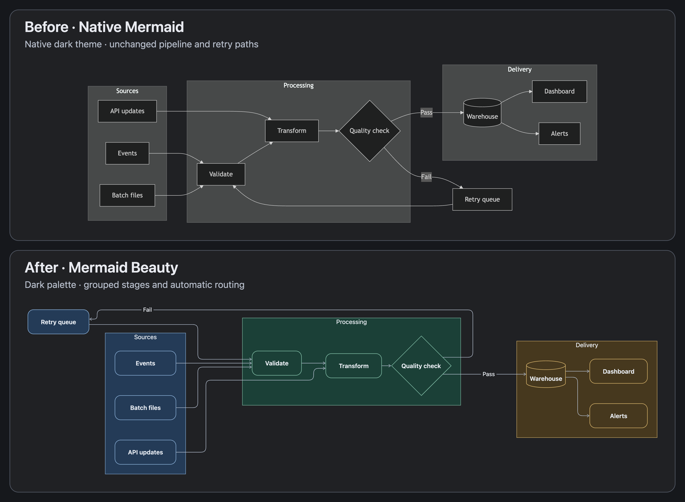

# Mermaid Beauty

Clearer Mermaid diagrams in Obsidian. Works with your existing `mermaid` blocks, without editing the source.

[中文说明](README.zh-CN.md) · [Feedback](#feedback)

This release workflow is reorganized into **Checks → Validation → Release**, with equal-width cards in each layer, fewer connector bends, and feedback routed below the main flow. All 11 nodes and 16 connections are preserved.

Both use the **[same Mermaid source](tests/browser/readme-sources.ts)** at the same scale: native Mermaid 11.13.0 with its default Dagre layout above, Mermaid Beauty with automatic ELK layout and the default Fresh palette below. No manual positioning or coloring. Click the image to enlarge.

[Watch the 15-second before/after demo](docs/images/demo.gif) · [Copy the three public examples](docs/examples.md)

Chinese labels and dark mode

Long Chinese labels, a review loop, and grouped stages:

A data pipeline with a retry path in dark mode:

Each comparison keeps the source and display scale identical. The native baseline uses Mermaid 11.13.0 with Dagre; the dark example also uses its native dark theme.

## Install

Requires **Obsidian 1.12.7+**. Open **Settings → Community plugins → Browse**, search for **Mermaid Beauty**, then install and enable it. [Community listing](https://community.obsidian.md/plugins/mermaid-beauty)

### Manual installation

1. Download `main.js`, `manifest.json`, and `styles.css` from the [latest release](https://github.com/theChildinus/mermaid-beauty/releases/latest).
2. Put all three files in `<vault>/.obsidian/plugins/mermaid-beauty/`.
3. Reload Obsidian and enable **Mermaid Beauty**.

## Your first diagram

Open a note that already contains a `mermaid` block, then switch to Reading view or move the cursor outside the block in Live Preview. You can also paste a [public example](docs/examples.md) into a new note.

If Obsidian asks to display Mermaid diagrams, allow it only if you trust the vault. The setting is **Settings → Editor → Show Mermaid diagrams in notes**. Mermaid Beauty leaves that permission under your control.

If the diagram still looks unchanged, run **Mermaid Beauty: Refresh diagrams** from the command palette. Check that enhanced rendering is enabled and that the diagram type is not set to **Native**. Source mode displays code; explicit source styling remains authoritative.

New installations show a one-time welcome notice. Open **Getting started** from the settings or command palette for setup and export guidance.

## Adjust the appearance

Open **Settings → Mermaid Beauty**:

- **Colors:** Fresh, Cool, and Natural coordinated palettes, single-hue presets, or custom colors. Follows Obsidian's light or dark theme.
- **Size and layout:** adjust text size, connector width, corners, spacing, and fit-to-width.
- **Per diagram type:** share defaults, use a separate style, or keep native rendering. Supports flowcharts, sequences, class diagrams, mind maps, charts, and more.

New installations use coordinated colors. Upgrades keep your existing appearance; choose **Default appearance → Color style → Coordinated colors** to try it.

## Copy and export images

Use the **Copy and export** icon in the bottom-left corner of an enhanced diagram, or search the command palette for **Mermaid Beauty: Copy diagram as SVG**, **Copy diagram as PNG**, **Export diagram as SVG**, or **Export diagram as PNG**. The icon stays in place while the diagram scrolls, leaves the bottom-right corner for Mermaid Zoom, and takes no extra row. If the note contains multiple rendered diagrams, the command lets you choose one.

- **Copy SVG:** copies a vector image with the current styles. Paste into an Obsidian note to save an SVG in that note's attachment folder and insert its image reference. Keep Beauty enabled between copying and pasting. Other apps must support SVG images; unsupported devices show a save-file suggestion.
- **Copy PNG:** paste into documents, messages, or slides. If the device blocks clipboard images, use Export as PNG.
- **Export as SVG… / Export as PNG…:** on desktop, choose a filename and location in the system save dialog. The first export starts in Obsidian's configured attachment folder; successful exports remember the chosen folder. The completion notice shows the location and a **Show in folder** button. Cancelling writes no image. Mobile exports still save to the configured attachment folder. Your note and Mermaid source stay unchanged.
- Images retain the current light/dark appearance. PNG uses 2× resolution where possible, capped at 4,096 pixels per side and 16 million pixels to bound memory use. SVG retains vector geometry; text uses fonts available in the viewer.
- Diagrams containing external image resources cannot be exported. The export does not fetch or upload those resources.

On touch screens the export button stays visible with a 44-pixel target. For dense diagrams, turn off **Fit to width** to keep text at its natural size and scroll horizontally.

## Feedback

Found a problem or have an idea? [Choose the matching issue form](https://github.com/theChildinus/mermaid-beauty/issues/new/choose):

- [Report a reproducible bug](https://github.com/theChildinus/mermaid-beauty/issues/new?template=bug_report.yml)
- [Suggest an improvement](https://github.com/theChildinus/mermaid-beauty/issues/new?template=feature_request.yml)

Search [existing issues](https://github.com/theChildinus/mermaid-beauty/issues) first. Include the plugin and Obsidian versions, platform, reproduction steps, and the smallest relevant public Mermaid example. Never post vault contents, proprietary diagrams, credentials, or other sensitive data.

## Notes

- Rendering runs locally. Diagram text is not uploaded; images linked in the source may need a network connection.
- Explicit source styles take precedence. If another plugin also replaces Mermaid rendering, disable one of them if they conflict.
- The bundled renderer is about **6 MB**, above Obsidian Sync Standard's 5 MB file limit. Install separately on each device. Mobile devices have not been tested.

For cross-device setup and troubleshooting, see [the usage guide](docs/usage.md). Browser checks include narrow layouts; they do not establish iOS or Android compatibility.

[MIT License](LICENSE) · [Third-party notices](THIRD_PARTY_LICENSES.md)
