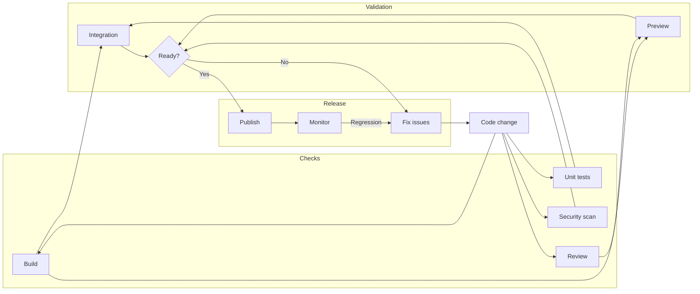
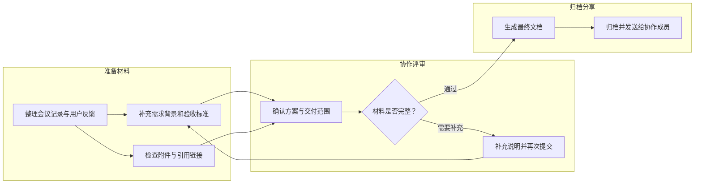
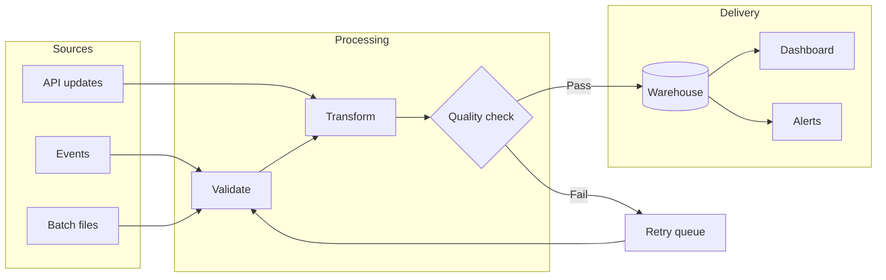

# Public Mermaid examples / 公开示例

Copy a complete fenced block into an Obsidian note, then open Reading view or leave the block in Live Preview. These are fictional, public examples; they contain no vault or business data.

将完整代码块复制到 Obsidian 笔记，再切换阅读视图，或在实时预览中移出光标。示例均为虚构公开内容，不含个人笔记或业务资料。第三组请在深色主题下查看。

The README and demo render exactly these sources. The native comparison uses Mermaid 11.13.0 with Dagre and the matching light/dark theme; Mermaid Beauty uses its bundled engine and automatic layout. The display scale is the same on both sides.

## Release workflow

## Chinese labels and review loops

## Data pipeline in dark mode

